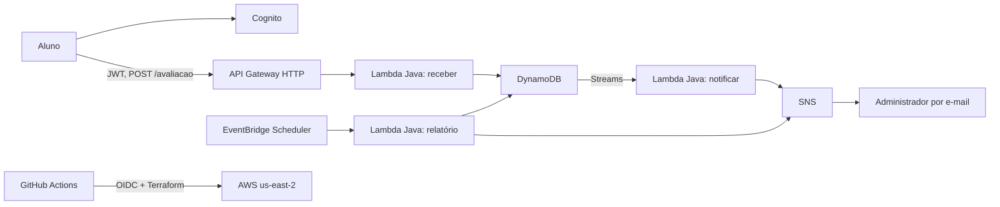

# Feedback do Aluno

Plataforma acadêmica serverless para receber avaliações de aulas, alertar administradores sobre notas críticas e enviar um relatório semanal. O código é público; credenciais de teste e tokens **não** são publicados.

## Arquitetura



As três funções Lambda seguem responsabilidades distintas. O registro usa a semana ISO como chave de partição e um UUID como chave de ordenação no DynamoDB. O relatório consulta apenas a partição da semana anterior, calcula média, contagens por dia e urgência e inclui cada descrição, nota e data. Mensagens grandes são divididas em partes identificadas. O aviso crítico inclui descrição, urgência e data de envio.

## API

| Método | Rota | Autenticação | Corpo |
| --- | --- | --- | --- |
| POST | `/avaliacao` | Access token JWT do Cognito | `{"descricao":"texto","nota":0..10}` |

Notas **0 a 3** são `CRITICA`; notas **4 a 10** são `NORMAL`. O caminho ASCII `/avaliacao` corresponde ao exemplo `/avaliação` do enunciado. O [manual público de uso](docs/USO-DA-API.md) ensina a obter um token e testar a API com `curl` ou PowerShell. O acesso administrativo aos relatórios é por e-mail SNS, confirmado pelo destinatário.

## Pré-requisitos

- Conta AWS de estudante **315205584370**, aplicação na região **us-east-2**. O login do projeto usa **us-east-1**; a região do login não altera a região da infraestrutura.
- AWS CLI **2.32.0 ou superior** para `aws login`, Terraform **1.10.0 ou superior**, Java **21**, Maven **3.9** e GitHub CLI autenticado como `wandrad3`.
- Projeto público no SonarQube Cloud `wandrad3profile-projects`, com chave `wandrad3profile-projects_wandrad3-feedback-do-aluno`, e token de análise cadastrado no GitHub. A organização ainda precisa ser vinculada ao GitHub para habilitar a integração com PRs.
- E-mail do administrador para alertas e relatórios. Após criar a inscrição SNS, o destinatário precisa clicar no link de confirmação.

Confira o alvo antes de qualquer Terraform:

```bash
aws login --profile feedback-aluno-projeto --region us-east-1
aws sts get-caller-identity --profile feedback-aluno-projeto
aws configure set credential_process 'aws configure export-credentials --profile feedback-aluno-projeto --format process' --profile feedback-aluno-terraform
aws configure set region us-east-2 --profile feedback-aluno-terraform
aws sts get-caller-identity --profile feedback-aluno-terraform
```

O campo `Account` deve ser `315205584370` nos dois perfis. `feedback-aluno-terraform` fornece credenciais temporárias ao provedor Terraform. Não use o perfil `default` desta máquina, pois ele aponta para outra conta.

## Build e qualidade

```bash
mvn clean verify
```

O Maven produz `target/feedback-do-aluno.jar`, um JAR com as dependências necessárias às três funções. O JaCoCo exige **100% de linhas e 100% de ramos cobertos no código Java de produção**. O Sonar importa `target/site/jacoco/jacoco.xml` e seu quality gate bloqueia o deploy. A pipeline falha se faltar qualquer parâmetro Sonar; não há exclusões de cobertura para código de produção.

## Bootstrap do Terraform e deploy

O bootstrap cria um bucket S3 exclusivo para o estado, com versionamento, bloqueio público e criptografia, além do provedor OIDC e uma função IAM específica para `main`. Para repositórios GitHub criados após julho de 2026, a confiança OIDC inclui os IDs imutáveis do dono e do repositório.

```bash
gh api repos/wandrad3/feedback-do-aluno --jq .id
cd terraform/bootstrap
terraform init
terraform apply -var="github_repository_id=<ID_REPOSITORIO>"
```

Execute o bootstrap somente com `AWS_PROFILE=feedback-aluno-terraform` depois de conferir o ID da conta. O arquivo de estado local de bootstrap fica ignorado pelo Git e deve ser guardado até o encerramento. O bucket é `feedback-aluno-tfstate-315205584370`.

Configure o novo repositório no GitHub. Informe o token sem colocá-lo em histórico de shell nem em arquivos versionados:

```bash
gh secret set SONAR_TOKEN -R wandrad3/feedback-do-aluno
gh secret set EMAIL_ADMIN -R wandrad3/feedback-do-aluno
gh variable set SONAR_ORGANIZATION -R wandrad3/feedback-do-aluno --body 'wandrad3profile-projects'
gh variable set SONAR_PROJECT_KEY -R wandrad3/feedback-do-aluno --body 'wandrad3profile-projects_wandrad3-feedback-do-aluno'
```

As duas variables Sonar e os secrets `SONAR_TOKEN` e `EMAIL_ADMIN` já estão cadastrados no GitHub. O projeto público foi criado manualmente e ainda não está vinculado ao repositório. Conecte a organização Sonar ao GitHub e associe o projeto a `wandrad3/feedback-do-aluno` em **Administration → General Settings → Repository binding**. O workflow em `.github/workflows/ci.yml` testa PRs e, após um merge em `main`, executa testes, cobertura, Sonar, validação Terraform e `terraform apply`. A autenticação GitHub → AWS usa OIDC; nenhuma chave de acesso AWS fica no GitHub ou no código. A saída do Terraform mostra URL da API, ID do cliente Cognito e ID do User Pool.

### Implantação atual

O deploy na conta **315205584370**, região **us-east-2**, passou no [GitHub Actions](https://github.com/wandrad3/feedback-do-aluno/actions/runs/42668488101) em 9 de novembro de 2026. A API respondeu `401` sem token e `201` com um token de teste do Cognito; o usuário e a avaliação fictícia foram removidos após o teste.

| Identificador público | Valor |
| --- | --- |
| URL da API | `https://vilam86911.execute-api.us-east-2.amazonaws.com` |
| ID do cliente Cognito | `7l8o6012lm01h37ositatnsn36` |
| ID do User Pool | `us-east-2_N2DycwX8K` |

O administrador precisa confirmar o e-mail **AWS Notification - Subscription Confirmation** para ativar alertas críticos e relatórios semanais. Confira o estado com `aws sns list-subscriptions-by-topic` no tópico `arn:aws:sns:us-east-2:315205584370:feedback-aluno-notificacoes`.

Para testar localmente um `plan` com o perfil correto:

```bash
cd terraform/app
terraform init -backend-config="bucket=feedback-aluno-tfstate-315205584370" -backend-config="region=us-east-2"
TF_VAR_email_admin='<EMAIL>' terraform plan
```

No PowerShell, defina `$env:TF_VAR_email_admin` antes do comando `terraform plan`. O e-mail fica no estado remoto criptografado e não deve ser incluído em `terraform.tfvars` versionado.

## Usuário de demonstração

O usuário `professor-demo` foi criado no User Pool e seu login foi validado. A senha forte está apenas no manual privado `D:\wstech\projetos\feedback-do-aluno-acesso-professores.md`, fora do Git e com acesso local restrito. Entregue esse arquivo aos professores por um canal privado. O `cognito_client_id` e a URL da API são identificadores públicos e podem constar do guia. Troque a senha ou exclua o usuário depois da avaliação.

## Monitoramento e custos

- CloudWatch Logs retém sete dias de logs por função. O código não registra a descrição das avaliações.
- Três alarmes CloudWatch monitoram erros das Lambdas e publicam no mesmo SNS dos alertas. Verifique também as métricas de execução, throttling e duração no console.
- API Gateway limita chamadas a 5 por segundo, com burst 10; o DynamoDB usa 1 RCU e 1 WCU provisionados; as Lambdas usam 512 MB e não ficam em VPC. Isso reduz recursos fixos e evita NAT Gateway.
- Confirme no console AWS Billing o plano e o consumo do Free Tier. Franquias são compartilhadas na conta e o custo zero não é garantido se o uso exceder os limites.
- Notificações via DynamoDB Streams e SNS têm entrega ao menos uma vez; em caso de repetição por retry, um alerta pode chegar duplicado.

Essas decisões abordam segurança (JWT, IAM restrito, criptografia e ausência de chaves permanentes), confiabilidade (eventos desacoplados, retries e alarmes), excelência operacional (Terraform, CI/CD, logs), eficiência (consultas por semana e funções leves) e otimização de custos (serviços serverless, limites e retenção curta), conforme os pilares do AWS Well-Architected Framework.

## Destruição após a avaliação

No GitHub Actions, abra **Testes, Sonar e AWS → Run workflow** na branch `main`, marque `destroy` e digite `DESTROY-315205584370`. A opção é `false` por padrão. O workflow confirma o ID da conta, executa `terraform destroy` da aplicação e remove bucket de estado, versões de objetos, função IAM e provedor OIDC exclusivos deste projeto. O repositório público permanece como registro da entrega. Não execute essa opção antes do encerramento da nota: avaliações, usuários e relatórios armazenados serão apagados.

Se o workflow parar antes da limpeza do bootstrap, não apague manualmente o estado sem verificar o resultado do `terraform destroy`. Revise os recursos com tag `Projeto=feedback-aluno` na conta correta e retome a limpeza quando a aplicação estiver totalmente removida.

## Organização do repositório

| Caminho | Conteúdo |
| --- | --- |
| `src/main/java` | Domínio e três handlers Lambda. |
| `src/test/java` | Testes unitários e de fluxo. |
| `terraform/modules/plataforma` | Módulo reutilizável da aplicação. |
| `terraform/app` | Instância da plataforma em us-east-2. |
| `terraform/bootstrap` | Estado remoto e acesso OIDC da pipeline. |
| `docs/USO-DA-API.md` | Manual público de autenticação e chamadas. |

## Problemas comuns

| Sintoma | Verificação |
| --- | --- |
| `401` no POST | Use `AccessToken`, não a senha nem um token expirado. |
| Avaliação `201`, mas sem e-mail | Confirme a inscrição SNS e confira logs da Lambda `notificar`. |
| Pipeline falha no Sonar | Confirme `SONAR_TOKEN`, organização, chave e projeto importado. |
| `AccessDenied` no deploy | Confirme a conta `315205584370`, a função OIDC e a confiança para o ID imutável do repositório. |
| `terraform init` falha | Confirme a existência do bucket de estado e a região `us-east-2`. |

## Limites conhecidos

O projeto foi dimensionado para demonstração acadêmica, não para grande volume. O envio de e-mail exige a confirmação do SNS; relatórios grandes são divididos em várias mensagens. A API não inclui painel web nem consulta administrativa sob demanda.
